# 头部结构
相较于卢米斯法，我们用方块概括头部更容易定位。从正面看，传统“三庭五眼”中，纵向范围是从发际线到下巴，横向也是两边发际边缘。我们可以据此划分出方块，在此基础上切割出头部的外轮廓，即添加颅顶、添加侧面宽度，并按三七分切割出下颌线。

<figure style="text-align: center;">
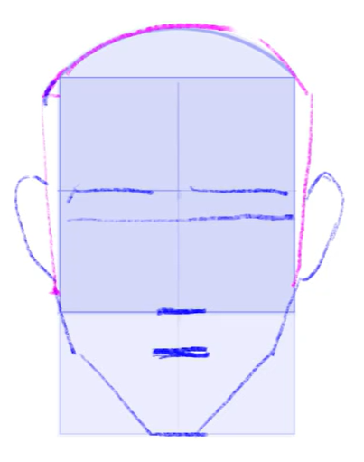
<figcaption>头部正面比例</figcaption>
</figure>

不同年龄段的头部正面比例有差异。对于小崽子，颅顶更高，脸更宽，下巴更短，耳朵也更靠下；少女则稍微长开了一点，脸没有那么宽，下巴长度也和成人差不多；少年唯一的区别就是下巴会有一个小平面。

<figure style="text-align: center;">

  

    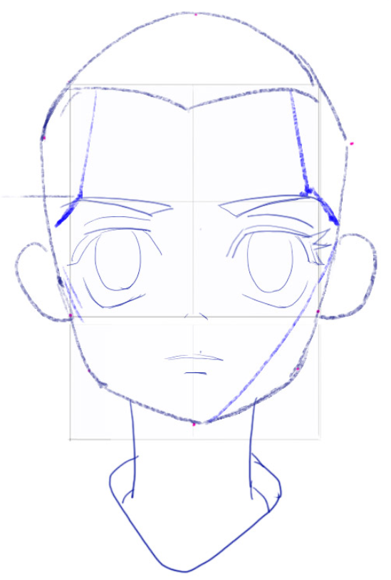
    
小孩头部正面比例

  

  

    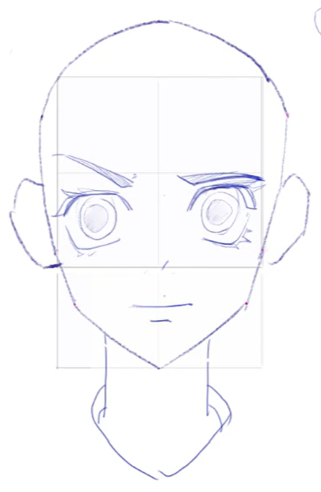
    
少女头部正面比例

  

  

    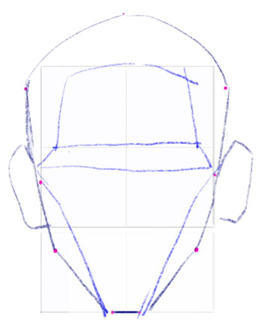
    
少年头部正面比例

  

</figure>

接下来看侧面，会比正面复杂一些。除了颅顶，还要添加后脑勺、面部和五官、下颌线。颅顶无论什么比例都可以，后脑勺也相对简单。由于枕骨会被压平一些，所以不要连到方块底部，连到下方 $\frac{1}{4}$ 处即可。

面部和五官则比较复杂。面部按弧度连到一半的位置，这里被称为山根，是一个小斜坡，然后再向下连接到下巴。鼻子从山根的任意位置出发（一般在中间），斜度比 $45^\circ$ 小一些，然后向下倾斜 $15^\circ-30^\circ$ 左右连接到面部，底部即方块底部。接着从鼻底一半的位置向下画一个弧度，连接到下面方块靠下 $\frac{1}{4}$ 的位置，上宽下窄，这就是嘴巴的弧度。

最后连接下颌线，做一个三七分连接到比方块小一圈的圆，在 $30^\circ$ 范围内都可以。

<figure style="text-align: center;">
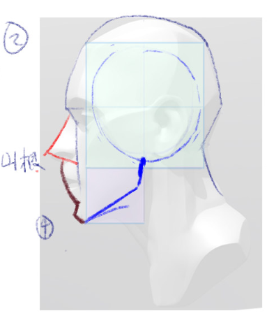
<figcaption>头部侧面比例</figcaption>
</figure>

成人和儿童最重要的区别在于山根的位置，儿童山根长而缓，成人山根短而急。在此基础上，儿童的脸更宽，鼻子更短更翘，耳朵也更靠下：

<figure style="text-align: center;">
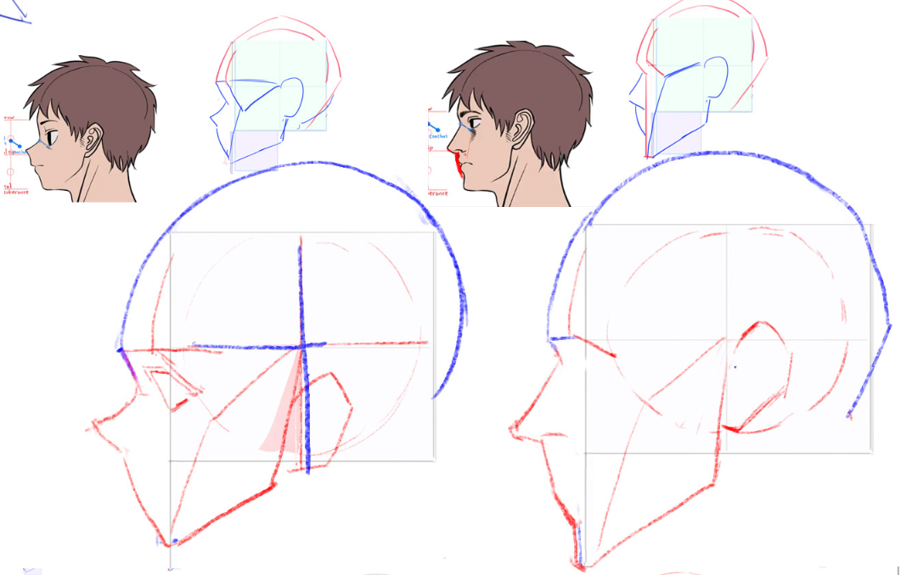
<figcaption>成人儿童差异</figcaption>
</figure>

然后我们在方块的基础上绘制卢米斯头部。

先搭建基础框架：在顶面和正面沿中间的十字线撑起四个半弧，形成基础脚手架。其中，顶面的两个半弧用于确定颅顶高度；正面纵向的半弧表示面部中线；正面横向的半弧表示眉骨高度和面部弧线。

其次画侧面的切面。由于头部并不是一个标准的正方体，侧面的切面不会完全贴在方块上，而是会略向外凸起。

接着画颞线。它位于眉峰附近，也即正面横向半弧向内约两指距离处，是头部的正侧转折线。从正面看，这条线并非完全垂直，而是向内收的。

再连接发际线，确定好额头的位置。

接下来确定眼眶位置。考虑到颞线经过眉尾，只需要将末端连接到侧面圆盘上即可，但实际上有很多讲究。连接圆盘的位置越靠下，眼眶越大、越可爱；反之眼眶越小，气质偏凌厉。考虑到透视，这里左眼处的粉色线和右眼的粉色线并不对应，真正的粉色线已经被眼睛遮挡住了。眼眶的凹陷程度根据角色而定。一般男生从眉骨到眼窝再到鼻梁的转折较大，鼻梁较长；女生眼睛更大、眼窝更浅，鼻梁转折更柔和，也显得更可爱。

然后处理面部厚度。和侧面一样作一个斜坡然后向下连接即可，注意是有厚度的。

而后从侧面圆盘引出颧骨线。因为颧骨有厚度，所以从眼眶下方一些的位置出发，再分两段连接到下巴。由于颧骨线和脸颊线一样是向内收的，因此两边并那么不对称，只要外轮廓好看即可。

最后连接下颌线。同样是做一个三七分连接到侧面圆盘，在 $30^\circ$ 范围内都可以。

<figure style="text-align: center;">
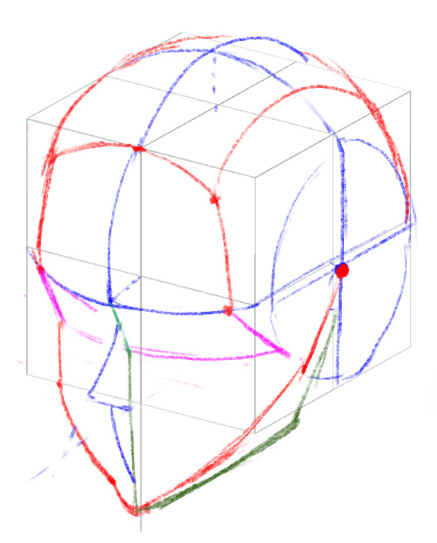
<figcaption>卢米斯头部</figcaption>
</figure>

回顾一下我们第一堂课学的方块定位，侧面是眉尾到耳根，正面是眉尾连线，中线是额头到下巴，和我们这堂课的内容是一致的。

> 画卢米斯头部的时候，轮廓的重要性异常显著。生套透视的话，很容易画出奇怪的外轮廓。

卡通比例比较特别。额头会更鼓，颧骨的连线转折也更弱：

<figure style="text-align: center;">
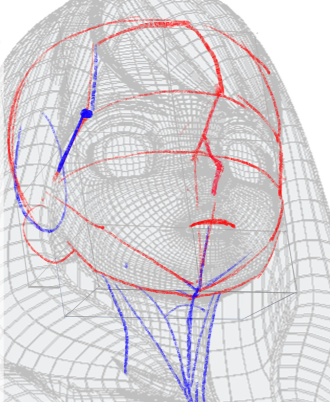
<figcaption>卡通比例</figcaption>
</figure>

有一些比较刁钻的角度，下颌线只露出一点点，容易被当成颧骨线：

<figure style="text-align: center;">
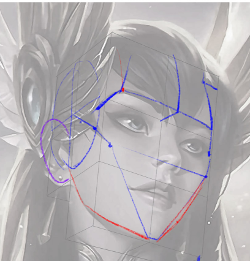
<figcaption>刁钻头部</figcaption>
</figure>

# 五官
## 眼睛
眼睛的基本结构如图。除了我们熟悉的眉毛、眼睑和眼珠以外，要注意的就是眉弓骨的结构。上眼睑覆盖在眉弓骨上，形成 Y 字形的转折结构。从图中可以看到，睫毛从眼皮边缘靠内一点的位置长出：

<figure style="text-align: center;">
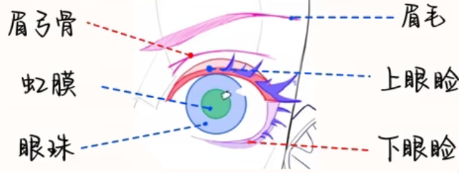
<figcaption>眼睛结构</figcaption>
</figure>

眼睛和眉弓骨都可以分成三段来理解。眼睛整体呈双锥体，嵌在眉弓下方，并向内凹陷。所以和胸腔背面一样，这里的透视也是“近小远大”。

<figure style="text-align: center;">

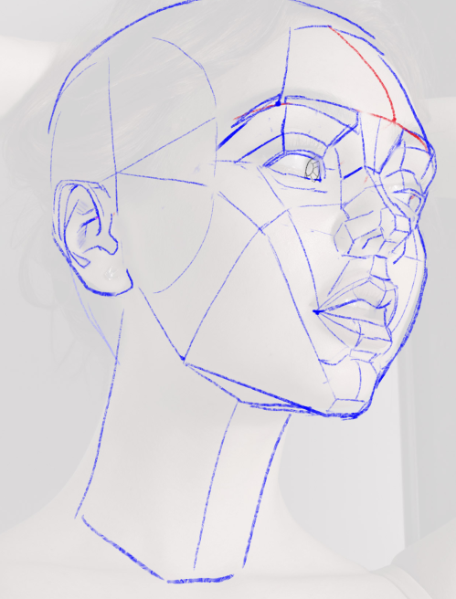
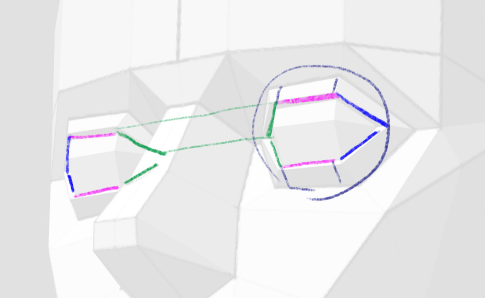

<figcaption>眼睛体积</figcaption>
</figure>

眼睛的造型很多变。眼睛之间夹的距离，上下三段的长度、夹角、斜率等都会影响气质。比如对于成男，外侧一段的夹角就需要比较弱：

<figure style="text-align: center;">
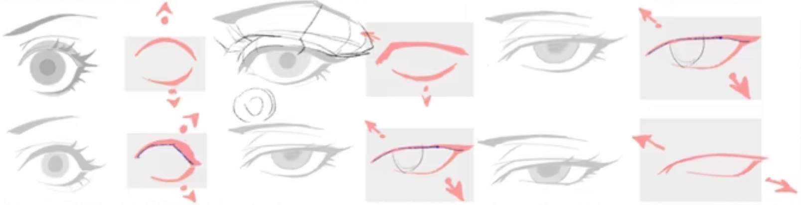
<figcaption>眼睛造型</figcaption>
</figure>

眼睛的定位方法也很重要：

1. 先确定额头与下巴的连线及颞线。
2. 颞线取一半是眉尾。
3. 眉尾附近是眼尾。
4. 根据“三庭五眼”定出另一只眼睛。
5. 根据透视画出双锥体。

<figure style="text-align: center;">
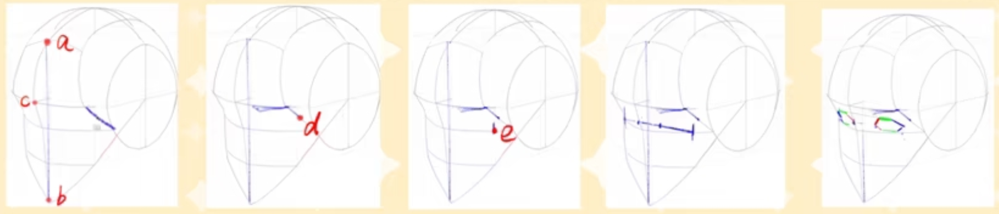
<figcaption>眼睛定位</figcaption>
</figure>

也可以从眉毛来定位，这个方法似乎更加方便：

<figure style="text-align: center;">
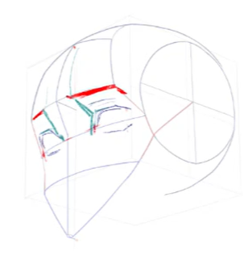
<figcaption>眼睛定位2</figcaption>
</figure>

有两个需要注意的细节，一是外眼角转折更急促，这和外侧一段夹角比较弱一致；二是眼睛整体是倾斜的，从卢米斯定位眼眶位置那里也可以看出来。

最后，需要确保两只眼睛的视线对焦。逻辑上，虹膜是一个约占眼球可见面积一半的圆，其中约 $\frac{1}{3}$ 会被眼皮遮挡。考虑到透视关系，虹膜相对于正视方向转动的角度越大，视觉上就会越扁。瞳孔则是一个凹陷结构，因此随着虹膜转动角度增大，瞳孔相对于虹膜中心的偏移也会越明显。高光始终位于虹膜表面。对焦也就是说两条眼球与虹膜的连线要有交点。

<figure style="text-align: center;">
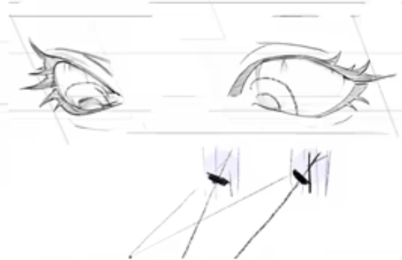
<figcaption>虹膜对焦</figcaption>
</figure>

## 鼻子
鼻子的结构相对简单。我们先将圆弧形的眉骨剖面切分成梯形，再画出鼻子的侧面图形；然后添加厚度，注意鼻尖处窄、鼻翼处宽；再连接眉骨和鼻梁，将蓝色眉骨中间的方块部分 AB 与鼻梁连接，鼻根类似订书钉的结构；最后将代表鼻翼的点 E、F 向上抬起一点，做一点转折。

<figure style="text-align: center;">

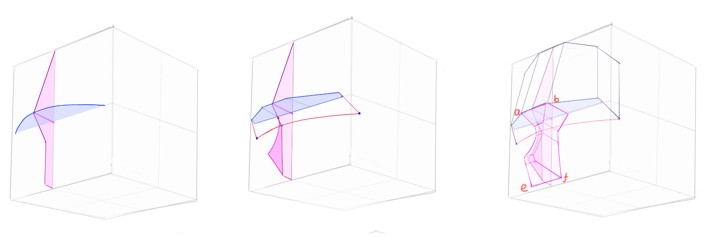
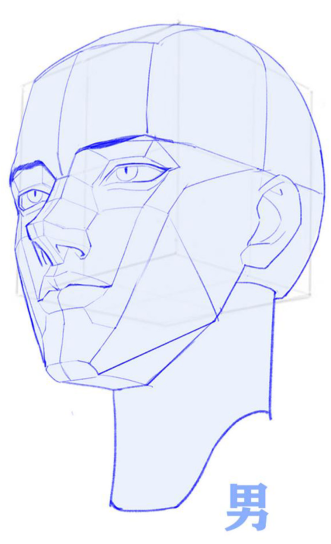

<figcaption>鼻子结构</figcaption>
</figure>

## 嘴巴
嘴巴的刻画首先要确定嘴缝，即在之前确定的嘴巴弧度位置，画出类似订书钉的结构。接着，用折叠纸片的方式表现嘴巴的转折，并连接两侧嘴角，建立嘴部的体积。然后刻画唇珠，在嘴部中央的小方块上画一个倒立的小三角体，以表现唇珠的体积。之后减弱转折，使嘴部呈现出柔和的肉感。最后，从鼻底连接到上唇顶点，塑造人中的体积；下嘴唇的各个点则向面部延伸，以表现颌唇沟的体积。

<figure style="text-align: center;">
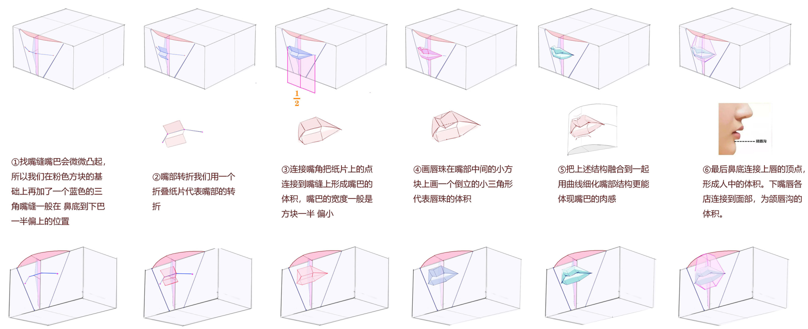
<figcaption>嘴巴结构</figcaption>
</figure>

张开嘴巴时，唇缝变为上下两个订书钉，在这个基础上继续细化就行。这两个订书钉和眼睛类似，也是整体倾斜的：

<figure style="text-align: center;">
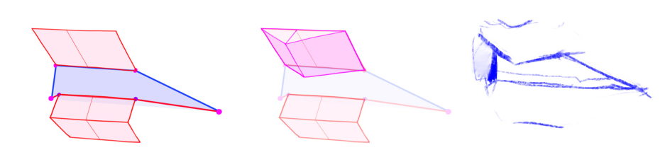
<figcaption>张开的嘴巴结构</figcaption>
</figure>

## 耳朵
耳朵整体沿着下颌线的方向生长，外形可以概括为一块棺材板。首先，添加一个具有厚度的面片，并表现出面片本身的转折。然后添加耳屏，表现为一个小凸起；接着添加对耳屏，其形状类似法杖，并将其与耳屏连接。最后刻画耳内软骨，是向外凸起的一块体积，延伸至耳垂。软骨内部还有一个 U 字形结构，用来表现其内部的体积关系。

<figure style="text-align: center;">
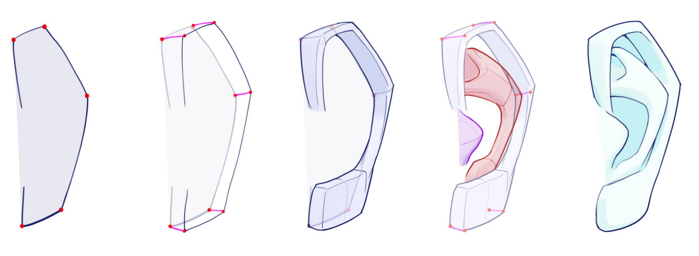
<figcaption>耳朵结构</figcaption>
</figure>

# 头颈肩连接
头颈肩的连接，首先确定下巴底部的面，将其概括为一个三角体。脖子对准下颌线，半径约为下颌线长度的 $\frac12$，以此为参考画出圆柱，并将其连接到胸腔顶端的三角体上。

接着进行细化。考虑到喉咙凸起，中间是上宽下窄的形状，可以概括为一个三角锥体。以此作为分界，可以确定胸锁乳突肌的位置。胸锁乳突肌整体类似一个“从”字结构，中间两束比较熟悉，旁边两束是较薄的片状结构，连接到锁骨靠内 $\frac13$。最后补充斜方肌，完成头颈肩的连接。

<figure style="text-align: center;">
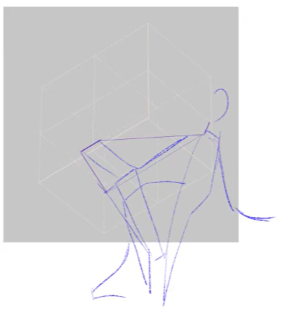
<figcaption>头颈肩连接</figcaption>
</figure>