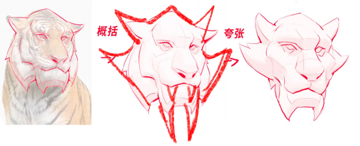
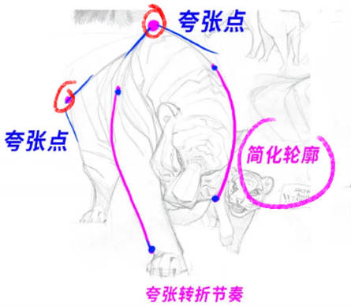
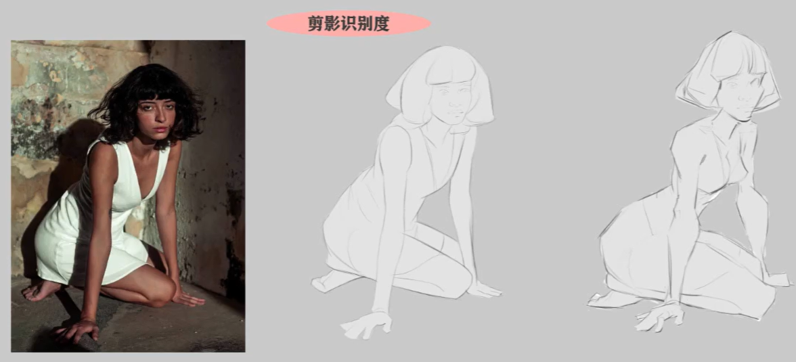
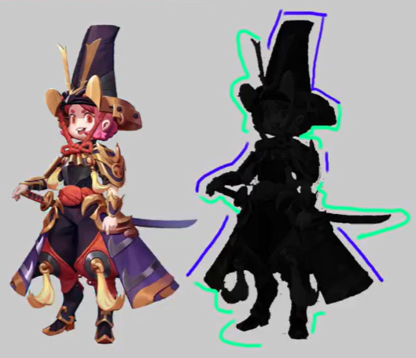
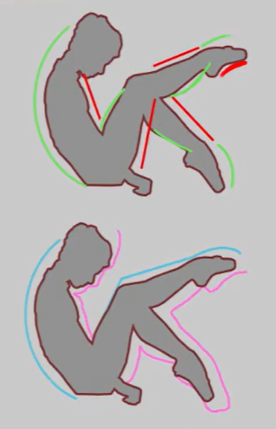

# 图形概括
我们既可以通过选择图案的最大转折点概括成大图形，也可以切分成若干小的图形；但无论如何，第一原则是信息完整且简洁。一般我们只选择不超过五边形的图形。

小的图形也要加强趋势，不等边、不等角、不规则。稍微复杂一点的是膨胀型和收缩型的，都是利用了曲直对比。

提取的图形需要概括和夸张。将图形原本比较独特的地方更加夸大，特色就会更加鲜明：

<figure style="text-align: center;">

<figcaption>图形的夸张</figcaption>
</figure>

不同的图形会给人不同的心理感受，既有好的一面也有坏的一面。圆形柔和无棱角，显得可爱、安全、可信赖，但也容易被解读为妥协、圆滑甚至贪婪。三角形稳定威严又带有速度感与神秘感，但尖角同样会让人联想到攻击性和危险。矩形强壮坚韧、简单正直，不过规整的直角在另一面也意味着固执、笨重和不懂变通。

图形也需要节奏，本质上是在对比之中找变化。大小、穿插、形状、疏密、起伏等都可以用来做对比，形成图形的节奏。画面的细节一般放在中心、转折和末端等比较突出的位置，其他地方可以适当地敷衍一些。

剪影轮廓有四个基本原则：

1. 剪影轮廓要清晰
2. 剪影要传递足够观看者分辨内容的信息
3. 轮廓要有疏密对比
4. 轮廓要有曲直对比

例如，这里我们通过调整剪影，既让人物的各个部位表现得更加明显，也让图形更有节奏感：

<figure style="text-align: center;">

<figcaption>剪影传递信息</figcaption>
</figure>

轮廓需要有疏密的对比，也要有曲直的对比：

<figure style="text-align: center;">

  

    
    
疏密对比

  

  

    
    
曲直对比

  

</figure>