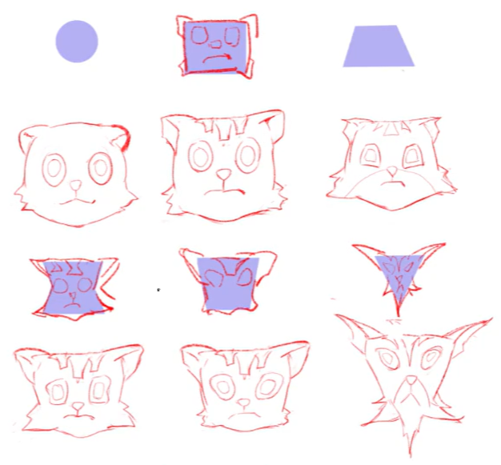
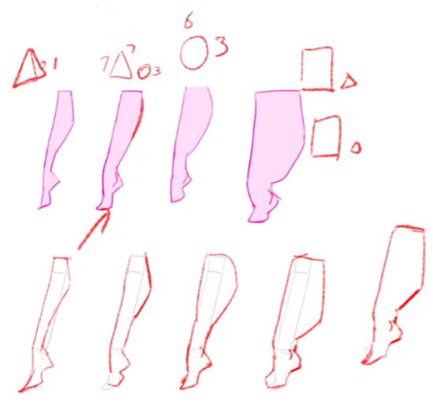

# 图形概括
我们既可以通过选择图案的最大转折点概括成大图形，也可以切分成若干小的图形；但无论如何，第一原则是信息完整且简洁。一般我们只选择不超过五边形的图形。

小的图形也要加强趋势，不等边、不等角、不规则。稍微复杂一点的是膨胀型和收缩型的，都是利用了曲直对比。

提取的图形需要概括和夸张。将图形原本比较独特的地方更加夸大，特色就会更加鲜明：

<figure style="text-align: center;">

<figcaption>图形的夸张</figcaption>
</figure>

不同的图形会带给人不同的心理感受，既有积极的一面，也有消极的一面。在角色设计中，通常会选取一到两种主要图形，并将角色的各个部分统一到这几种图形语言之中。

圆形柔和、没有棱角，容易给人可爱、安全、值得信赖的感觉，但也可能被解读为妥协、圆滑，甚至贪婪。三角形具有稳定感和威严感，同时带有速度感与神秘感，但尖锐的边角也容易让人联想到攻击性和危险，倒三角又让人觉得不稳定。矩形给人强壮、坚韧、简单、正直的印象，但规整的直角也可能显得固执、笨重，缺乏变通。

图形同样需要节奏，其本质是在对比中寻找变化。大小、穿插、形状、疏密、起伏等都可以作为对比的依据，从而形成图形的节奏感。

在划分疏密时，有一个简单且实用的原则，就是黄金分割。可以按照四六分的比例对画面进行划分，并优先对较小的部分进行细化。这是因为画面的视觉中心、转折和末端等突出部位，往往也集中在这些划分位置附近，因此可以有意识地将细节安排在这些区域，而其他部分则适当敷衍一些。这样既能突出画面的重点，也能避免细节分布过于平均。

剪影轮廓有四个基本原则：

1. 剪影轮廓要清晰
2. 剪影要传递足够观看者分辨内容的信息
3. 轮廓要有疏密对比
4. 轮廓要有曲直对比

例如，这里我们通过调整剪影，既让人物的各个部位表现得更加明显，也让图形更有节奏感：

<figure style="text-align: center;">

<figcaption>剪影传递信息</figcaption>
</figure>

轮廓需要有疏密的对比，也要有曲直的对比：

<figure style="text-align: center;">

  

    
    
疏密对比

  

  

    
    
曲直对比

  

</figure>

# 人体躯干
正如第一堂课中所学，我们通常会让胸腔与骨盆形成约 $140^\circ$ 的夹角。这种姿态体现在整体图形上，就是 K 字形。一般来说，男性挺胯时，整体呈现反 K 字形，采用一比一加七三分的比例；女性挺胸收腹时，则呈现正 K 字形，采用四六分加六四分的比例。相比于用两个方块反复调整位置，这种概括方式更加方便快捷。

<figure style="text-align: center;">

<figcaption>K 字形</figcaption>
</figure>

# 图形构成
我们来进一步研究设计中的图形构成。如前所述，同一个物体可以用不同的图形进行概括，而不同的概括方式也会赋予物体不同的视觉特征。

<figure style="text-align: center;">

<figcaption>不同的图形概括</figcaption>
</figure>

运用在人身上也是如此，在决定了图形之后，原本的比例也可以适当放弃：

<figure style="text-align: center;">

<figcaption>腿部的图形变化</figcaption>
</figure>