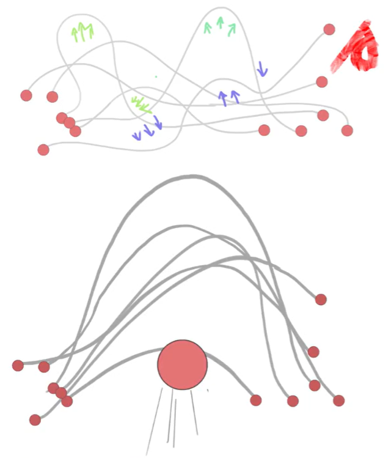
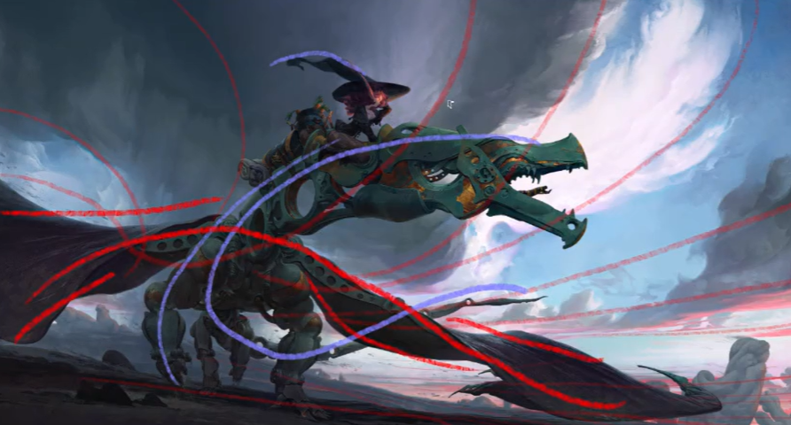
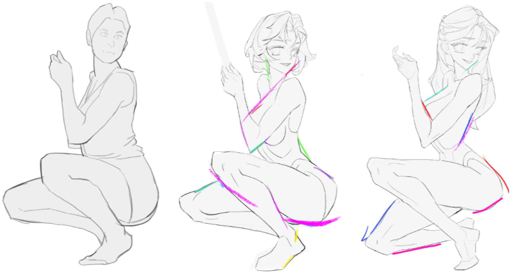
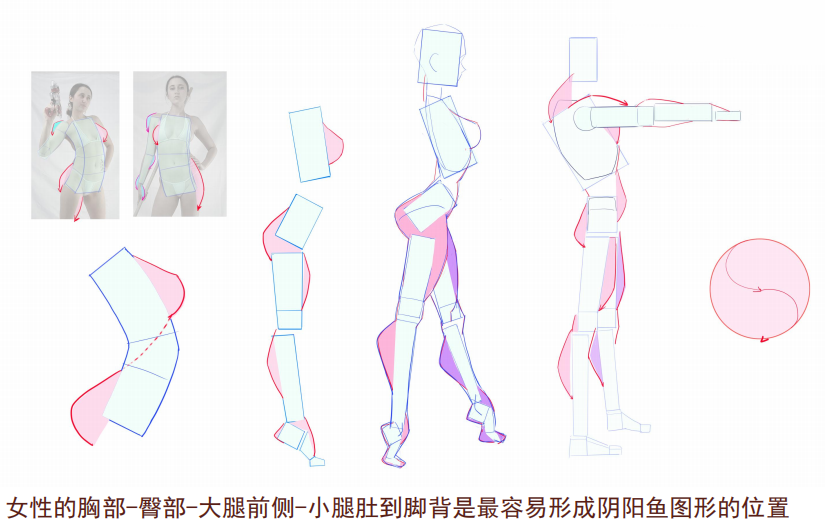
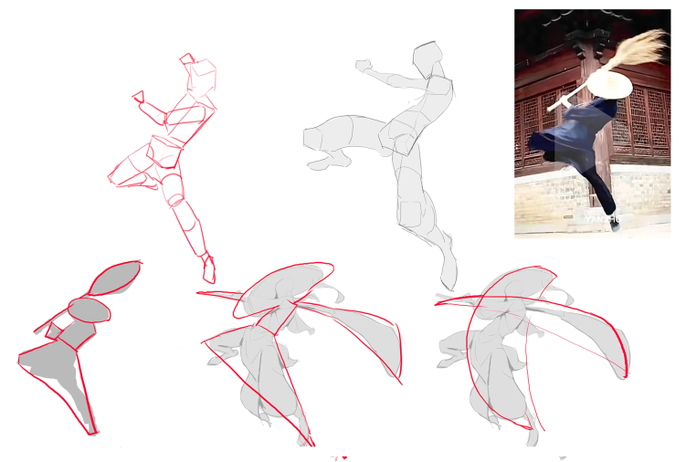
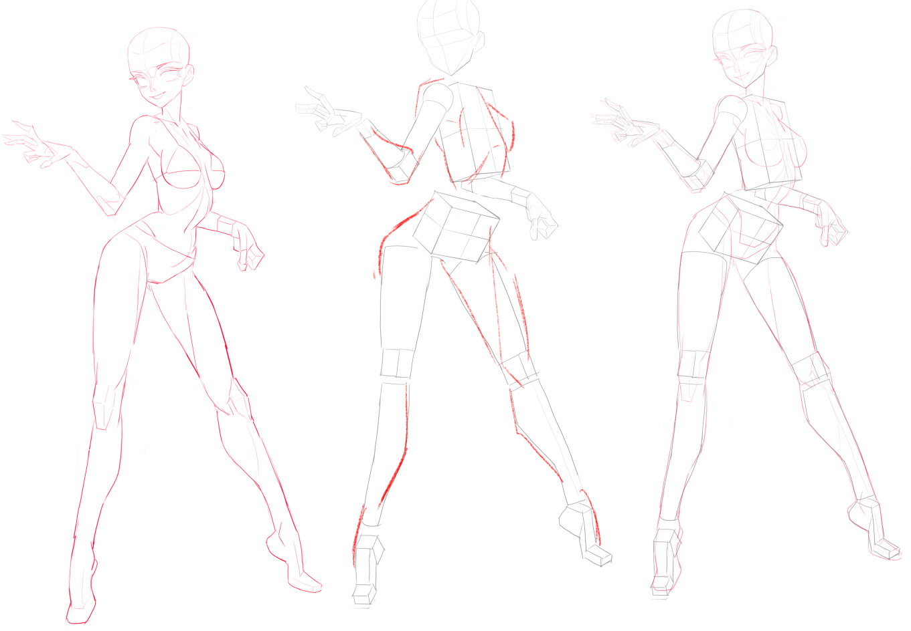
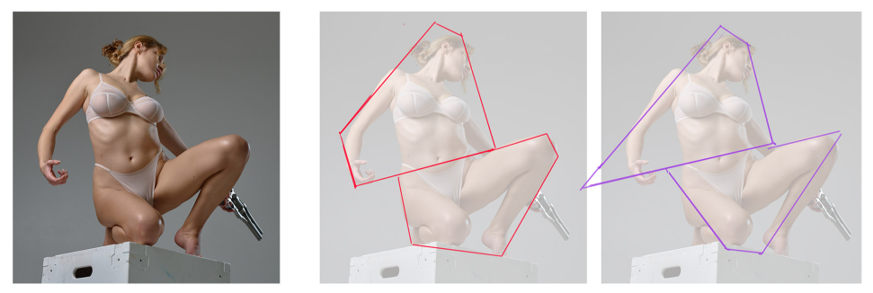

# 动态优化
## 基础要求
我们知道构成讲究的是点线面，人体的构成也不例外。对于人体动态而言，线体现在胸腔与骨盆约 $140^\circ$ 的夹角上。如果有一定的动态，还可以让人胯比带有一些角度。面则更多体现在整体图形的概括上，要注意整体图形是否干脆利落。前者相对容易做到，而后者通常可以通过调整动作或加强透视来实现。

## 趋势与连续线
凌乱不堪的线显然是没有美感的，但如果线条之间具有统一的趋势，能联想到简单的图形，看起来就会更加协调。

<figure style="text-align: center;">

<figcaption>趋势</figcaption>
</figure>

不同的趋势线汇聚于视觉焦点，就会自然地吸引人的视线：

<figure style="text-align: center;">

<figcaption>视觉引导</figcaption>
</figure>

而这种趋势很大程度上是由连续的线带来的。因此在画面中，我们要尽量使用可以相互联系的长线段，就会给读者造成很有趋势的感觉。当然，这种连续线完全是一种图形上的感觉，所以可以有多种解法：

<figure style="text-align: center;">

<figcaption>连续线</figcaption>
</figure>

在人体中，就有很多“阴阳鱼”，可以处理成连续的线：

<figure style="text-align: center;">

<figcaption>阴阳鱼</figcaption>
</figure>

> 尽管如此，也并非所有人体都能找到连续线。如果要画的人体比较壮而且没有什么动态，就是很难找到连续线的。

## 常见构图
画人体的常见构图就三种：D 形、S 形、多边形。

D 形常见于大动态。在动态非常强烈时，才会有 D 字形出现：

<figure style="text-align: center;">

<figcaption>D 形</figcaption>
</figure>

S 形常见于站姿。站立时，需要平衡，所以会自然的出现阴阳鱼，进而出现 S 形：

<figure style="text-align: center;">

<figcaption>S 形</figcaption>
</figure>

坐姿等其他姿势比较自由，因此我们往往需要用稍微复杂一些的多边形去概括：

<figure style="text-align: center;">

<figcaption>多边形</figcaption>
</figure>

> 很明显这些都是我们了解过的构成内容，从趋势的角度看似乎像是一个个模板，但如果真正从图形的视角来看，就出现的水到渠成了。