# 衣褶
衣褶的结构是力的表现形式。

## 受力
在日常生活中，衣褶一般会受到三种力：重力、拉力、挤压力。根据受到的力的种类不同，衣褶会进一步表现出七种主要的不同形态。

### 重力
重力是最常见的受力形式。受重力影响的布料，其形态规律比较简单，就是从支点向四周扩散出射线，然后连接出底面。

当只有一个支点时，直接从支点画出几条射线，然后连接底面即可：

<figure style="text-align: center;">
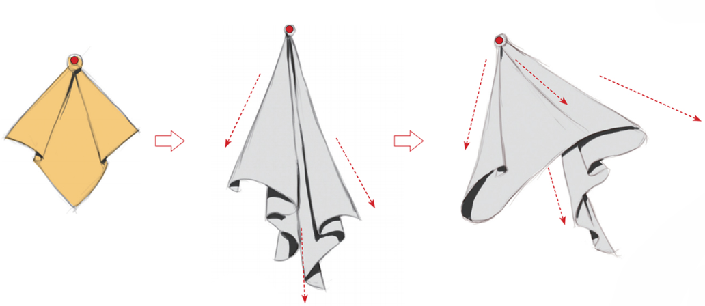
<figcaption>一点垂落型</figcaption>
</figure>

两个支点时，射线会相互影响，产生 V 字型的褶皱，越往下褶皱越松散、越稀疏：

<figure style="text-align: center;">
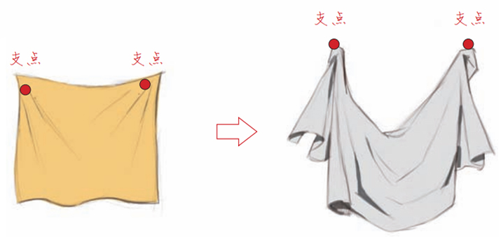
<figcaption>两点兜布型</figcaption>
</figure>

支点更多时，我们就可以就可以根据画面需要随意挑选自己喜欢的支点了，再从这些支点向外扩散，确定布料的褶皱走向：

<figure style="text-align: center;">
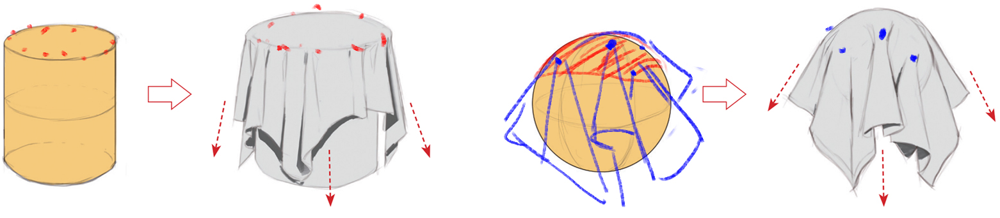
<figcaption>更多支点</figcaption>
</figure>

最后考虑底面如何连接，其实只需要注意透视关系，按弧线连接即可。仰视时，近处的弧线转折更大，远处的转折会比较小；俯视时，甚至看不到另一个面，随意：

<figure style="text-align: center;">
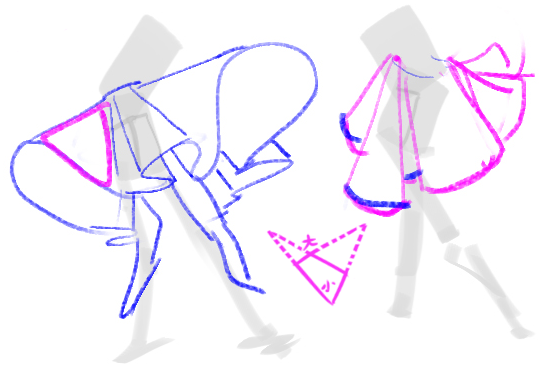
<figcaption>底面连接</figcaption>
</figure>

### 拉力
拉力在表现形式上与重力没有区别，二者主要区别在于支点的位置变成了布料被拉紧的地方。这些绷紧的位置会顺着透视向四周扩散出射线，起到类似支点的作用。

拉力常见于腋下、裆部、膝盖等关节处，以及臀部凸起等身体比较饱满的位置。当这些部位的布料受到牵拉而绷紧时，周围就会形成放射状的线条。

<figure style="text-align: center;">

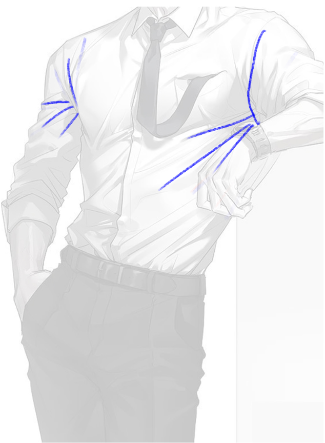
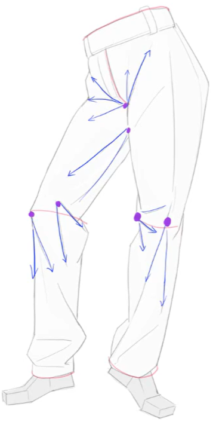

<figcaption>拉力的表现</figcaption>
</figure>

### 挤压力
挤压力也类似，一般出现在 $\lt 90^\circ$ 的夹角处，会有很多沿透视从内向外的小而深的起伏。

<figure style="text-align: center;">
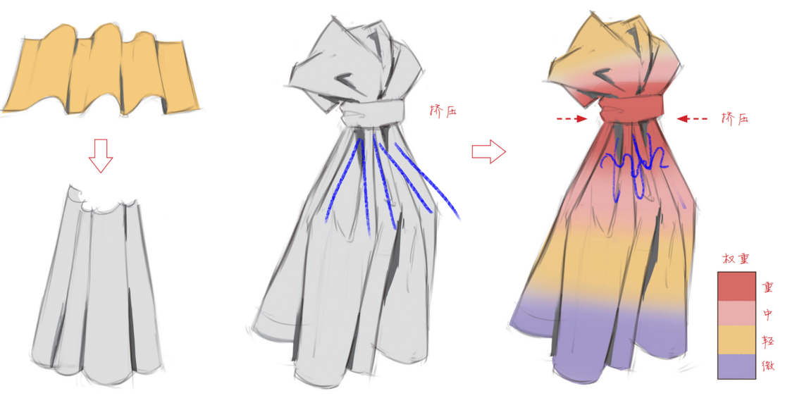
<figcaption>挤压力</figcaption>
</figure>

拉力和挤压力往往是相互对抗的，我们一般选择一种着重表现就可以得到比较合理的褶皱线。

<figure style="text-align: center;">
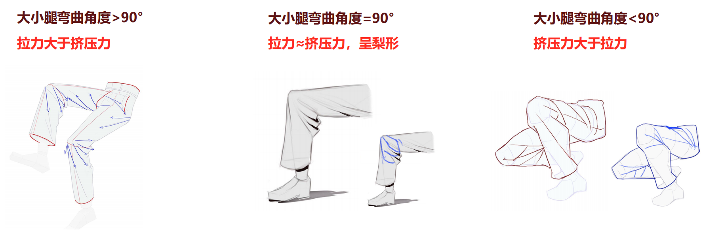
<figcaption>拉力与挤压力对抗</figcaption>
</figure>

> 事实上，力的类型不太重要，褶皱线都是从支点出发沿透视方向向外扩散。区分不同的受力类型，主要是为了帮助我们根据动作确定支点的位置，同时也便于确定 A 形结构。

## 体积
布料的基本体积可以理解为一个具有厚度的圆环。为了表现这种厚度，我们通常用 ICC 结构来概括。布料较薄时，两个 C 之间的距离较近，转折也更加急促；布料较厚时，两个 C 之间的距离较远，转折则更趋向于块面状。

<figure style="text-align: center;">
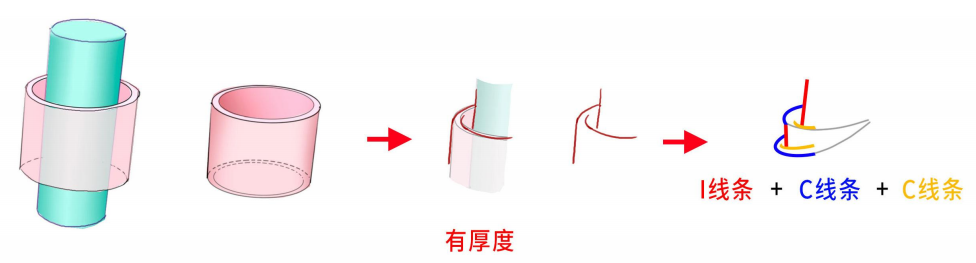
<figcaption>ICC 结构</figcaption>
</figure>

可以发现，一边呈现的是完整的 ICC 结构，另一边其实也是 ICC 结构，但被 C 挡住了一部分。事实上，只要能够看到褶皱的顶面，就可以看到完整的 ICC 结构：

<figure style="text-align: center;">
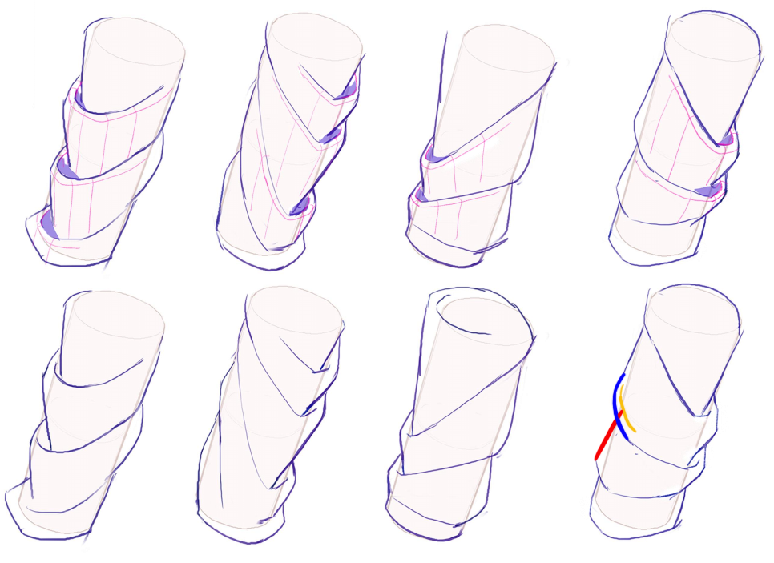
<figcaption>ICC 结构</figcaption>
</figure>

单纯依靠 ICC 结构的堆叠来理解体积可能会显得比较复杂。在实际处理时，我们可以用正 A 和反 A 来更简单地理解褶皱的平面结构。一般来说，拉力会形成正 A，挤压力则会形成反 A 以及凸起的反 A。在此基础上，再用 ICC 结构进行细化，就能将平面上的褶皱转化为具有体积感的结构。

<figure style="text-align: center;">
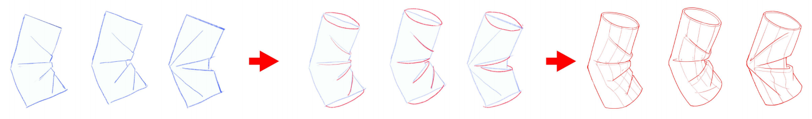
<figcaption>A 型褶皱</figcaption>
</figure>

## 流程
至此，我们可以总结出处理衣褶的通用流程。

1. 根据人体结构，确定衣服的整体体积。
2. 添加裁缝线，明确衣服的结构。
3. 结合衣服材质和人物动作，分析布料的受力情况。
4. 从构成角度对褶皱进行取舍和概括。
5. 最后添加体积。

# 头发
## 发际线
发际线的形状与头皮覆盖头颅的范围有关。从美人尖开始，沿着额头向两侧延伸至侧面圆圈，再顺着圆圈向下延伸。鬓角从眉峰处转折，后方则汇合到脖子的中线。

<figure style="text-align: center;">

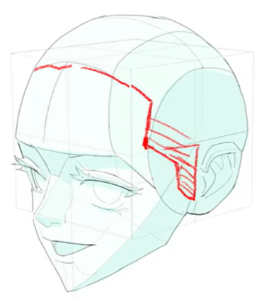
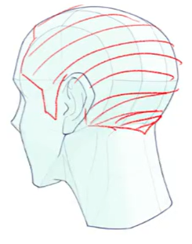

<figcaption>发际线</figcaption>
</figure>

头发通常先向上生长，再受到重力影响自然向下垂落，这个结构常被称作蟑螂窝。

<figure style="text-align: center;">
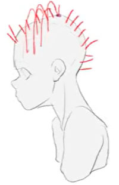
<figcaption>头发生长</figcaption>
</figure>

## 头发分区
头发一般分为四个区域，但根据发型不同，分区也可以有变化：

<figure style="text-align: center;">
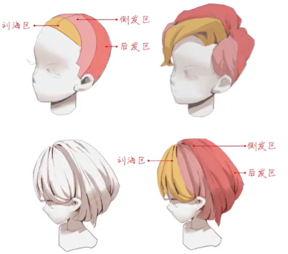
<figcaption>头发分区</figcaption>
</figure>

如图所示，确定发片分区，之后我们会对需要细化的部分进行细化：

<figure style="text-align: center;">

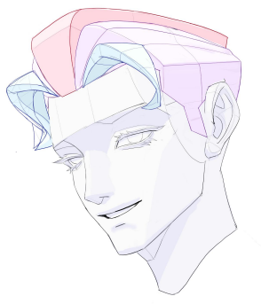
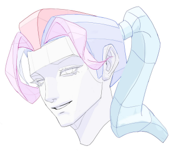

<figcaption>发片分区</figcaption>
</figure>

## 发片形状节奏
常见的发片有三种基本形状：三角形、D 型、K 型。前两种一般是单独出现，K 型则可以多个拼接：

<figure style="text-align: center;">

  

    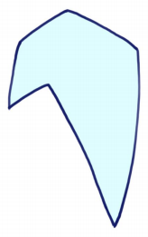
    
三角形

  

  

    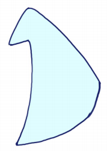
    
D 型

  

  

    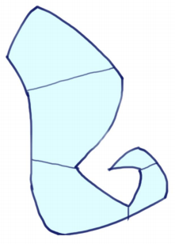
    
K 型

  

</figure>

接下来的细化分为三个步骤：

1. （可选但好用）添加蟑螂窝等转面

    <figure style="text-align: center;">
    

    

    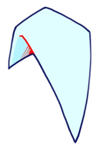
    
蟑螂窝

    

    

    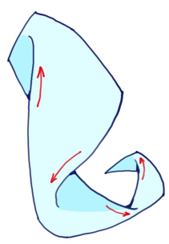
    
转面

    

    

    </figure>

2. 在转折和末端添加分叉

    <figure style="text-align: center;">
    

    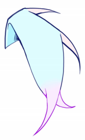
    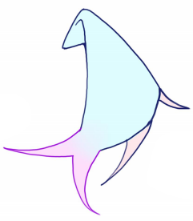
    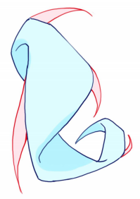
    

    <figcaption>头发分叉</figcaption>
    </figure>

3. 添加碎发和内切割细节

    <figure style="text-align: center;">
    

    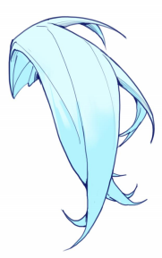
    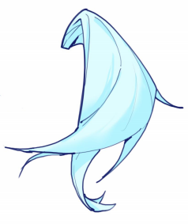
    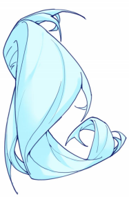
    

    <figcaption>碎发和细节</figcaption>
    </figure>